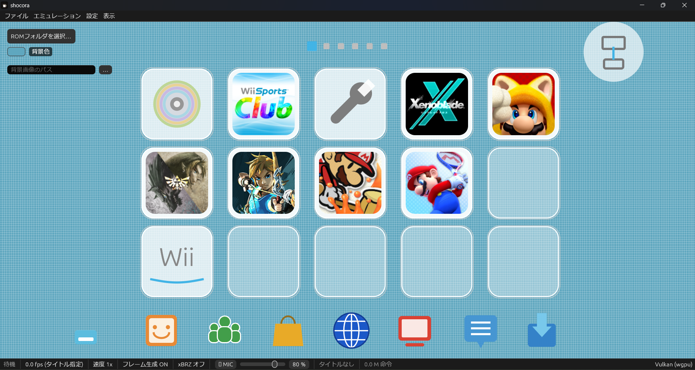

# shocora

<p align="center">
  
</p>

Wii U emulator written in Rust, structured after the hardware and system
software of the console. Its design references [Cemu](https://github.com/cemu-project/Cemu).

## Images

<p align="center">
  
</p>
<p align="center">
  
</p>
<p align="center">
  
</p>

## Quick Start

- Build

```text
cargo build --release
```

- Utils

```text
cargo xtask run [--graphics wgpu|vulkan|opengl] [-- TITLE_DIR | FILE.rpx]
cargo xtask test
cargo xtask icon   # gui/egui/assets/shocora.svg -> shocora.png, shocora.ico
```

## Features & Configuration Guide

### 🎨 Graphics & Display
* **Graphics Backends**:
  * `wgpu` (default): Automatically selects the best API (DX12 / Metal / Vulkan / GL).
  * `vulkan` / `opengl`: Forces the specified API.
* **3D Resolution**: Scalable from **2x to 8x** (up to 10,240px wide). Higher multipliers significantly increase VRAM usage.
* **Screen Upscaling**: GPU-accelerated xBRZ scaling from **2x to 6x**.
* **Frame Rate Control**:
  * **Default**: Preserves the title's native target frame rate.
  * **Force 60 fps**: Overrides to 60 fps (*Note: 30 fps logic-bound games will run up to double speed*).
  * **Max 30 fps**: Caps games that run excessively fast at 30 fps.

---

### 🎮 Controls & Input

#### Default Keybindings
| Button              | Key                          |
| :------------------ | :--------------------------- |
| **A / B / X / Y**   | `X` / `Z` / `S` / `A`        |
| **L / R / ZL / ZR** | `Q` / `W` / `1` / `2`        |
| **+ / −**           | `Enter` / `Backspace`        |
| **D-Pad**           | Arrow Keys (`↑` `↓` `←` `→`) |
| **Left Stick**      | `I` `J` `K` `L`              |

#### Controller & Hotkeys
* **Gamepad**: Plug-and-play support mapped by physical button position (Right face button = Wii U's A). Customize under `[pad_bindings]` in `shocora.toml`.
* **Game Speed Toggle**: Cycle speeds (`1x` → `2x` → `3x` → `4x` → `0.5x`) via `Tab`, pressing the Left Stick, or clicking the status bar speed indicator.
  * *Note: Using Left Stick press for speed toggle blocks that input from reaching the game.*

---

### 📂 Setup & File Structure
* **Configuration File**: Automatically saved to `shocora.toml`.
* **Game Directories**: Specify folders under `rom_dirs` in `shocora.toml`. Supports extracted titles (`code`/`content`/`meta`) and `.rpx` files. Double-click a title in the list to boot.
* **Game Updates**: Set `mlc_dir` in `shocora.toml` to a Cemu-style `mlc01` directory. `skip_update_check = true` (default) allows launching titles without required updates.
* **Shader Cache**: Saved automatically in `shader_cache/` to reduce stuttering on subsequent runs.
* **Language**: Change in **Settings > General**. Edit or add `lang/translation.<code>.json` to customize translations.

---

### 🌐 Local Network Netplay
Allows 2-player sessions over LAN or VPN (e.g., Radmin VPN).

* **Host Setup (Player 1)**:
  * **Port**: Uses **TCP `47800`** (must be allowed through the firewall for external PCs).
  * **IP Address**: Enter your local or VPN IP (default `127.0.0.1` is local PC only). Optional password protection is supported.
  * **Give player 2 the rights of player 1**: Transfers GamePad control to the guest while disabling host inputs.
* **Guest Experience (Player 2)**:
  * Connects to the host's IP as a **Pro Controller** (mouse clicks act as GamePad touch inputs).
  * **Send buttons to the GamePad**: Switches guest controller inputs from Pro Controller to GamePad.
* **Connection & Security**:
  * Drops connection after 3 seconds of no response and automatically attempts to reconnect.
  * ⚠️ **Traffic is unencrypted. Only use Netplay on trusted networks (LAN or trusted VPNs).**

---

### 🛠 Debugging

Run headless boots for debugging via command line:

```bash
cargo run --release -p shocora_tests --example headless -- <TITLE_DIR> [FRAMES]
```

## References

- [docs/ref-wiiubrew](docs/ref-wiiubrew/01_emulator_architecture.md)
- [Wii U Architecture](https://www.copetti.org/writings/consoles/wiiu/)
- [Wii U Home Brew](https://wiiubrew.org/wiki/Main_Page)
- [Cemu](https://github.com/cemu-project/Cemu): Wii U Emulator written in  C++

## License

- SPDX-FileCopyrightText: (C) 2026 Cemu Project
- SPDX-License-Identifier: MPL-2.0
